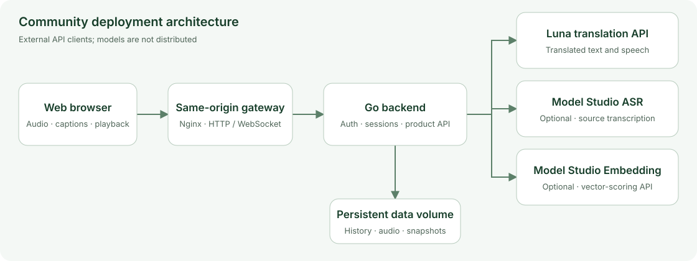

<p align="center">
  
</p>

<h1 align="center">Luna Translator</h1>

<p align="center">Speak, translate, listen. Bring different languages into the same conversation.</p>

<p align="center">
  <a href="README.md">中文</a> · English ·
  <a href="https://simultrans.lunalabs.cn/">Try the Web app</a> ·
  <a href="https://simultrans.lunalabs.cn/welcome/">Product</a> ·
  <a href="https://github.com/VUILabsHub/Luna-Translator/releases">Downloads</a> ·
  <a href="https://simultrans.lunalabs.cn/api-docs">API docs</a>
</p>

<p align="center">
  <a href="LICENSE"></a>
  <a href="https://github.com/VUILabsHub/Luna-Translator/actions/workflows/ci.yml"></a>
</p>

## Speak, translate, listen

Follow a talk in another language, present an idea to listeners who speak different languages, or take turns in a face-to-face conversation. Luna Translator provides source captions, translated text and speech, then saves the session for replay and sharing.

This repository contains a self-hosted **Web frontend and Go backend**. Run it on your computer or server, change the interface, extend the application, or integrate model services through provider adapters. Recognition and translation use external APIs; the application requires no local GPU.

> The first community release focuses on Web: solo translation, Chinese–English turn-taking, history, replay and sharing. The default is a clearly labeled simulation. Actual recognition and translation require your own provider credentials.

## News

- **2026-10-30 · [v0.1.0](https://github.com/VUILabsHub/Luna-Translator/releases/tag/v0.1.0)**: First Web + Go community release with Docker Compose startup, Luna / Model Studio adapters, persistent history and audio, revocable sharing, and public CI.

## From live conversation to replay

| Scenario | Workflow |
|---|---|
| Solo translation | Choose input and target languages, read captions and play translated speech; select up to three targets. |
| Face-to-face conversation | Alternate between Chinese and English speakers, switching the active side and viewing captions on both panels. |
| Session replay | Open history, read the saved transcript, and play or download source and translated WAV audio. |
| Sharing | Create an expiring snapshot link, viewable without the workspace password, and revoke it when needed. |
| Development | Exercise the simulated flow without credentials, or send PCM16 WAV input at real-time speed. |

### Core features

- **Live captions and speech**: Chinese / English input, with up to three target languages supported by the Luna public API.
- **Solo and turn-taking modes**: Preserve both speakers' transcripts and audio tracks.
- **Persistent sessions**: Browse, replay, download and delete history stored in a local Docker volume.
- **Revocable links**: Share snapshots for up to 30 days; revoking a link or deleting its source record makes it unavailable.
- **Provider adapters**: Integrate Luna translation, Model Studio ASR and Embedding through application-level clients.
- **Independent deployment**: Two containers, one data volume and an automatically generated workspace password; no external database or SMS service required.

## Architecture



Provider credentials stay in the backend. The browser captures and plays audio; the backend coordinates services and persists data. See [architecture and data](docs/architecture.md) and [provider contracts](docs/providers.md) for details. The extended guides are currently in Chinese.

## Quick start

### 1. Get the project

Install [Docker Engine / Docker Desktop with Compose](https://docs.docker.com/compose/install/), then clone:

```sh
git clone https://github.com/VUILabsHub/Luna-Translator.git
cd Luna-Translator
```

Alternatively, download and extract a ZIP or tar.gz from [Releases](https://github.com/VUILabsHub/Luna-Translator/releases). SHA-256 checksums are provided alongside the archives.

### 2. Start with one command

macOS / Linux:

```sh
sh ./start.sh
```

Windows PowerShell:

```powershell
./start.ps1
```

The script builds the Web and backend images, waits for health checks, and prints the workspace password. Open <http://localhost:8088> and sign in.

The first build needs access to public container images and npm / Go dependency registries. Docker deployment does not require Node.js or Go on the host. For ports, remote HTTPS, backups and upgrades, see the [deployment guide](docs/deployment.md).

> **Default simulation** produces fixed sample captions and a tone. It does not recognize or translate your speech. Simulated audio goes to your local backend; real mode sends audio to the configured providers.

### 3. Try a session

Choose input and target languages, start translation, complete the audio authorization flow, and speak. You can instead select an uncompressed PCM16 WAV file, which is sent at real-time speed. After completion, browse history, replay audio or generate a share link. Use the conversation mode for Chinese–English turn-taking.

## Connect model services

Configure only the capabilities you need:

| Capability | Recommended service | Requirements | Purpose |
|---|---|---|---|
| Translation | [Luna public API](https://simultrans.lunalabs.cn/api-docs) | Luna API key | Live translated text and synthesized speech; a fixed voice, with cloning disabled by default. |
| Source transcription | [Model Studio `qwen3-asr-flash-realtime`](https://help.aliyun.com/zh/model-studio/real-time-speech-recognition-user-guide) | API key, workspace and region | Source captions alongside the Luna stream. |
| Vector scoring | [Model Studio `text-embedding-v4`](https://help.aliyun.com/zh/model-studio/text-embedding-synchronous-api) | API key and full Embedding endpoint | A backend API for whole-utterance similarity scoring and developer extensions. |

Copy `.env.example` to `.env` (`cp .env.example .env` on macOS / Linux, or `Copy-Item .env.example .env` in PowerShell), then edit:

```dotenv
# Real translation. Luna alone provides translated text and speech.
DEMO_MODE=false
LUNA_API_KEY=your-own-luna-key

# Optional source transcription.
DASHSCOPE_API_KEY=your-own-model-studio-key
DASHSCOPE_WORKSPACE_ID=your-workspace-id
DASHSCOPE_REGION=cn-beijing

# Optional vector-scoring API. Use your own workspace endpoint.
DASHSCOPE_EMBEDDING_URL=https://your-workspace-id.cn-beijing.maas.aliyuncs.com/compatible-mode/v1/embeddings
```

Run the startup script again to apply the configuration. Without Model Studio ASR, Luna translated text and speech remain available, but source captions are unavailable. Accounts, costs, regions and concurrency limits are controlled by each provider. Each target language opens a separate upstream call and consumes quota.

The community UI pairs text by whole utterance or speaking turn. Embeddings score similarity; they do not provide validated sentence-level alignment. See [configuration and protocols](docs/providers.md) for more options. Keep your `.env` and credentials out of commits and public Issues.

## Local development

Requires **Node.js 22.12+ and Go 1.26.10+**. Install dependencies from the repository root:

```sh
npm ci
```

On macOS / Linux, start a simulated backend in one terminal:

```sh
DATA_DIR="$PWD/data" DEMO_MODE=true go -C backend run .
```

Start the frontend in another terminal:

```sh
npm run dev --workspace web
```

Open <http://localhost:5173>. The generated workspace password is in `data/admin-password`. Vite proxies application requests to the local backend on port `8080`.

Build and check:

```sh
npm run build
npm test
go -C backend test -race ./...
python3 scripts/check-public-content.py
```

| Directory | Contents |
|---|---|
| `web/` | Web pages, audio interaction, history and sharing. |
| `packages/core/`, `packages/ui-shared/` | Shared text state, protocols and browser audio logic. |
| `backend/community/` | Standalone workspace API, session coordination and persistence. |
| `backend/providers/` | External model-service client adapters. |
| `docs/` | Architecture, deployment, provider setup, validation and roadmap. |

## Release scope and roadmap

v0.1.0 is a **single-workspace deployment**. Everyone with its password shares history and model quota. Use separate deployments for separate users. Remote microphone access requires valid HTTPS.

Validation covers synthetic-speech Chinese–English translation in both directions, browser history and sharing, container startup and public CI. Physical microphone capture, headphones / echo behavior, Safari / Edge, Windows hardware and long-session load have not completed acceptance testing. See the [validation record](docs/validation.md).

Next priorities are Web compatibility, accessibility, provider adapters and alignment strategies, followed by multi-party meetings / RTC and Android / iOS source releases. See the [open-source roadmap](docs/open-source-plan.md).

## Official product and downloads

| Entry | Link |
|---|---|
| Product and Welcome page | [About Luna Translator](https://simultrans.lunalabs.cn/welcome/) |
| Online Web experience | [Official Web app](https://simultrans.lunalabs.cn/) |
| iOS app | [App Store: Luna翻译](https://apps.apple.com/cn/app/id6806330215) |
| Community source archives | [GitHub Releases](https://github.com/VUILabsHub/Luna-Translator/releases) |

The official product and self-hosted workspaces use separate accounts and data. The iOS app is available for download; mobile source releases follow the roadmap.

## Community and contributions

Use [Issues](https://github.com/VUILabsHub/Luna-Translator/issues) to report problems, discuss use cases and suggest features. Pull requests are welcome, especially for browser compatibility, accessibility, provider adapters, documentation and alignment strategies.

- [Contributing](CONTRIBUTING.md): Development checks and submission guidelines.
- [Security](SECURITY.md): Private reporting for credentials, recordings and vulnerabilities.
- [Third-party notices](THIRD_PARTY_NOTICES.md): Dependency, font and asset licenses.

## License

Application code is licensed under [Apache License 2.0](LICENSE); third-party components retain their own licenses. This repository does not distribute ASR, translation or Embedding alignment model weights, training code, training data or private inference implementations. Model services have their own usage terms.
