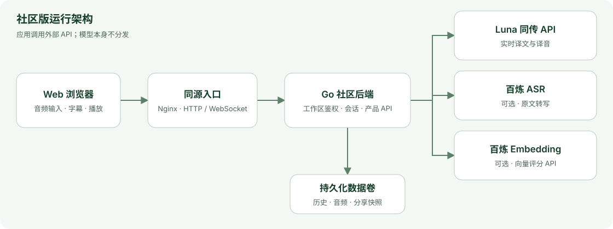

<p align="center">
  
</p>

<h1 align="center">Luna Translator</h1>

<p align="center">
  实时语音翻译，让不同语言的人听见彼此。
</p>

<p align="center">
  中文 · <a href="README.en.md">English</a> ·
  <a href="https://simultrans.lunalabs.cn/">在线体验</a> ·
  <a href="https://simultrans.lunalabs.cn/welcome/">产品介绍</a> ·
  <a href="https://github.com/VUILabsHub/Luna-Translator/releases">下载</a> ·
  <a href="https://simultrans.lunalabs.cn/api-docs">API 文档</a>
</p>

<p align="center">
  <a href="LICENSE"></a>
  <a href="https://github.com/VUILabsHub/Luna-Translator/actions/workflows/ci.yml"></a>
</p>

## 边说，边译，边听

听一场外语分享，向不同语言的听众介绍想法，或与面前的人轮流交谈——Luna Translator 将输入语音转换为原文字幕、目标语言译文与译音，并保留会话，方便之后回听和分享。

这个仓库提供可独立部署的 **Web 前端与 Go 后端**。你可以在自己的电脑或服务器上运行，修改界面、扩展业务流程，或接入自己的模型服务。应用通过外部 API 完成实际识别与翻译，本机部署无需 GPU。

> 当前社区版优先支持 Web：单人同传、中英双向对话、历史、回放与分享。默认启动的是有明确标识的模拟体验；实际识别和翻译需要配置自己的模型服务。

## 最新动态

- **2026-10-30 · [v0.1.0](https://github.com/VUILabsHub/Luna-Translator/releases/tag/v0.1.0)**：发布首个 Web + Go 后端社区版，提供 Docker Compose 启动、Luna / 百炼适配、历史与音频归档、可撤销分享，以及独立的公开 CI。

## 从实时交流，到回听分享

| 场景 | 如何使用 |
|---|---|
| 单人同传 | 选择输入和目标语言，查看原译文并播放译音；一次最多选择 3 种目标语言。 |
| 面对面对话 | 中英双方轮流发言，切换当前发言方，上下两侧分别查看对应语言字幕。 |
| 会后回听 | 打开历史，查看已保存文字，播放或下载原音与译音 WAV。 |
| 分享记录 | 为历史生成限时快照链接，接收者无需工作区密码即可查看；可随时撤销。 |
| 开发与联调 | 无模型密钥时走模拟流程，也可用 PCM16 WAV 按实时速度复现同传链路。 |

### 核心能力

- **实时字幕与译音**：支持中文 / 英文输入；目标语言由 Luna 公共 API 提供，最多同时输出 3 种。
- **单人和双向交互**：快速开始或中英轮流对话，保留双方的文字与音轨。
- **完整会话记录**：本地数据卷持久保存历史与音频，支持浏览、回放、下载和删除。
- **可撤销分享**：生成最长 30 天的分享快照；撤销链接或删除原记录后，链接失效。
- **可扩展服务接入**：通过应用层适配器调用 Luna 同传、百炼 ASR 与 Embedding。
- **独立部署**：两个容器、一个数据卷、自动生成工作区密码，无需外部数据库或短信平台。

## 参考架构



模型凭据保留在后端。浏览器负责采集和播放，后端负责服务编排与数据保存。完整接口和数据生命周期见 [架构说明](docs/architecture.md) 与 [服务协议](docs/providers.md)。

## 快速开始

### 1. 下载项目

安装 [Docker Engine / Docker Desktop 与 Compose](https://docs.docker.com/compose/install/)，然后克隆仓库：

```sh
git clone https://github.com/VUILabsHub/Luna-Translator.git
cd Luna-Translator
```

也可以从 [Releases](https://github.com/VUILabsHub/Luna-Translator/releases) 下载 ZIP 或 tar.gz 并解压；同页提供 SHA-256 校验文件。

### 2. 一条命令启动

macOS / Linux：

```sh
sh ./start.sh
```

Windows PowerShell：

```powershell
./start.ps1
```

脚本会构建 Web 与后端镜像、等待健康检查，并显示本部署的工作区密码。打开 <http://localhost:8088> 登录，即可体验。

首次构建需要访问公开镜像及 npm / Go 依赖源；Docker 部署无需本机安装 Node.js 或 Go。需要自定义端口、远程 HTTPS、备份或升级时，参见 [部署指南](docs/deployment.md)。

> **默认模拟模式**只显示固定示例字幕和提示音，不会识别或翻译实际语音。模拟音频进入本机后端；接入真实服务后，音频才会发送给所配置的提供方。

### 3. 试用一次会话

选择输入和输出语言，点击「开始同传」，完成音频授权后开始说话。也可先选择无压缩 PCM16 WAV，按实时速度发送测试音频。会话完成后，可以查看历史、回放音频或生成分享链接；面对面交流时切换「对话」模式。

## 接入模型服务

各项能力可以按需配置：

| 能力 | 推荐服务 | 接入准备 | 在社区版中的用途 |
|---|---|---|---|
| 同传 | [Luna 公共 API](https://simultrans.lunalabs.cn/api-docs) | Luna API Key | 实时译文与合成语音；固定音色，默认不开启声音克隆。 |
| 原文识别 | [百炼 `qwen3-asr-flash-realtime`](https://help.aliyun.com/zh/model-studio/real-time-speech-recognition-user-guide) | API Key、工作空间与地域 | 为 Luna 链路补充原文字幕。 |
| 向量评分 | [百炼 `text-embedding-v4`](https://help.aliyun.com/zh/model-studio/text-embedding-synchronous-api) | API Key 与 Embedding 完整接口地址 | 通过后端接口计算整段原译文相似度，供开发者调用与扩展。 |

先复制配置示例（macOS / Linux 使用 `cp .env.example .env`；PowerShell 使用 `Copy-Item .env.example .env`），再编辑 `.env`：

```dotenv
# 开启真实同传；只配置 Luna 时即可获得译文和译音。
DEMO_MODE=false
LUNA_API_KEY=your-own-luna-key

# 可选：补充原文识别。
DASHSCOPE_API_KEY=your-own-model-studio-key
DASHSCOPE_WORKSPACE_ID=your-workspace-id
DASHSCOPE_REGION=cn-beijing

# 可选：启用向量评分接口，地址以自己的工作空间配置为准。
DASHSCOPE_EMBEDDING_URL=https://your-workspace-id.cn-beijing.maas.aliyuncs.com/compatible-mode/v1/embeddings
```

重新运行启动脚本以应用配置。未配置百炼 ASR 时，Luna 译文和译音仍可使用，原文字幕不可用。服务开通、费用、地域和并发限制由各提供方决定；多个目标语言会分别建立上游调用并占用额度。

社区版按整段或每轮发言展示原译文。Embedding 提供向量评分，不能代替已验证的逐句对齐模型。更多参数和适配方式见 [模型配置与协议](docs/providers.md)。自己的 `.env` 和密钥应留在本机，不提交到仓库或公开 Issue。

## 本地开发

需要 **Node.js 22.12+、Go 1.26.10+**。在仓库根目录安装依赖：

```sh
npm ci
```

macOS / Linux 在一个终端启动模拟后端：

```sh
DATA_DIR="$PWD/data" DEMO_MODE=true go -C backend run .
```

在另一个终端启动前端：

```sh
npm run dev --workspace web
```

打开 <http://localhost:5173>。首次生成的工作区密码位于 `data/admin-password`；前端通过 Vite 代理连接本机 `8080` 后端。

构建与检查：

```sh
npm run build
npm test
go -C backend test -race ./...
python3 scripts/check-public-content.py
```

| 目录 | 内容 |
|---|---|
| `web/` | Web 页面、音频交互、历史与分享界面。 |
| `packages/core/`、`packages/ui-shared/` | 共享文本状态、协议与浏览器音频逻辑。 |
| `backend/community/` | 独立工作区 API、会话编排与持久化。 |
| `backend/providers/` | 外部模型服务客户端适配器。 |
| `docs/` | 架构、部署、服务接入、验收与路线图。 |

## 版本范围与路线图

v0.1.0 面向**单工作区部署**：使用同一部署密码的人共享历史与模型额度。不同用户需要独立部署；远程浏览器麦克风需要有效 HTTPS。

已完成真实合成语音的中译英 / 英译中、浏览器历史与分享、容器启动和公开 CI 验证。真人麦克风、耳机 / 回声、Safari / Edge、Windows 实机及长会话负载尚未完成验收，具体记录见 [验证说明](docs/validation.md)。

后续优先完善 Web 的兼容性、可访问性、模型适配和对齐策略，再扩展多人会议 / RTC，整理 Android 与 iOS 源码。完整安排见 [开源计划](docs/open-source-plan.md)。

## 官方产品与下载

| 入口 | 地址 |
|---|---|
| 产品介绍与 Welcome 页面 | [了解 Luna 翻译](https://simultrans.lunalabs.cn/welcome/) |
| 在线 Web 体验 | [打开官方网页版](https://simultrans.lunalabs.cn/) |
| iOS 应用 | [App Store：Luna翻译](https://apps.apple.com/cn/app/id6806330215) |
| 社区源码与发行包 | [GitHub Releases](https://github.com/VUILabsHub/Luna-Translator/releases) |

官方产品与独立部署的社区工作区使用各自的账号和数据。iOS 已有应用下载入口，移动端源码按后续路线推进。

## 交流与贡献

欢迎通过 [Issues](https://github.com/VUILabsHub/Luna-Translator/issues) 反馈问题、讨论场景和提出功能建议，也欢迎提交 Pull Request。当前适合参与的方向包括浏览器兼容、无障碍、模型适配、文档与对齐策略。

- [贡献指南](CONTRIBUTING.md)：开发检查与提交说明。
- [安全报告](SECURITY.md)：私有凭据、录音及安全问题的报告方式。
- [第三方声明](THIRD_PARTY_NOTICES.md)：依赖、字体与素材许可。

## 许可证

应用代码采用 [Apache License 2.0](LICENSE)，第三方组件遵循各自许可。本仓库不分发 ASR、同传、Embedding 对齐等模型的权重、训练代码、训练数据或内部模型推理实现；模型服务的使用条件由提供方规定。
